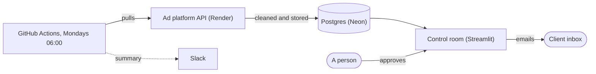

# Client Report Pipeline

**[Live demo →](https://client-report-pipeline-valentin.streamlit.app/)**

Most agencies rebuild the same client report every week by hand: pull the
numbers from each ad platform, drop them into a branded template, write the
commentary, check nothing looks off, send it. This does all of that on its own
every Monday, then waits for a person to approve each report before it's emailed.

The app is a control room over the pipeline: what the last run did, the reports
waiting for approval, any client's report for any week, and the alerts across
clients. A "How it works" page walks through the whole thing.

## What's in it

- **The runner.** `python -m runner` pulls each client's new data, cleans it, builds
  the report and records every step in a `runs` table. Failed requests are
  retried; one client failing never stops the others; `--retry-failed` re-runs
  only what failed.
- **A stand-in ad API.** `adsapi/` plays Google Ads, Meta, LinkedIn and a CRM:
  paginated, behind a key, and failing on purpose now and then.
- **Cleaning.** Duplicates, three date formats, dollars, a timezone slip, missing
  values. Every fix is counted and kept with the run.
- **Reports and alerts.** Headline numbers against the previous period, three
  charts, a plain-language read, and a "worth a look" section: spend up with no
  conversion lift, conversions down while spend held, CPC out of range, a campaign
  that stopped. Simple, explainable checks with a confidence on every flag.
- **Approval and email.** Nothing goes out until someone approves it, behind a
  passcode, and each report is sent once. Slack gets a summary of every run.
- **Theming.** Agency name, colour and logo live in `reports/themes/`; two ship.

## Time saved

Assembling one client report by hand (four exports, a template, charts,
commentary, an anomaly check) runs 60 to 90 minutes. Call it 75.

    manual, weekly:   4 reports x 75 min       = 5.0 hrs / client / month
    generated:        4 reports x 5 min review = 0.3 hrs / client / month
                                                 ~4.7 hrs saved / client

The 5 minutes is a person reading the report and approving it. Across a dozen
clients that's about 55 hours a month.

## The data

Nothing here is real. `data/generate.py` builds synthetic ad and CRM data for
three fictional clients: a hotel group, a fitness brand, a clinic. It's messy on
purpose, and one week a client's conversion pixel breaks while spend carries on.
Cleaning fixes the export quirks; the outage is a real event, so it survives and
the alerts catch it.

## Stack

Python, pandas, FastAPI, Postgres, matplotlib and Jinja, Streamlit, GitHub Actions.

## Structure

    adsapi/              the stand-in ad platform API (FastAPI, Docker)
    data/generate.py     synthetic data generator, seeded
    db/                  schema and grants, plain SQL
    pipeline/            API client, ingest, cleaning, metrics
    reports/             report building, alerts, themes, storage
    delivery/            approval, email, Slack
    runner.py            the scheduled run
    app/                 the Streamlit control room
    samples/             example reports, readable without running anything
    tests/               pytest, including against a real Postgres

## Running it locally

With Docker running, copy `.env.example` to `.env`, then:

    docker compose up -d --build
    set -a; . ./.env; set +a
    python -m pipeline.db init
    python -m runner
    streamlit run app/streamlit_app.py

Compose starts Postgres, the ad API and Mailpit, which catches email at
http://127.0.0.1:8025. `pytest` runs the database tests when `TEST_DATABASE_URL`
is set. Without Docker, `python -m reports.run` still writes reports from files.

## Deploying

The pipeline runs on GitHub Actions every Monday at 06:00 UTC (`pipeline.yml`),
with a manual button for one client, a chosen week, or only what failed.
`tests.yml` runs the tests on every push and scans for committed secrets.

- **Neon** holds Postgres. Create the `pipeline` and `app` roles with `CREATE ROLE`
  in the SQL Editor, not from the dashboard, which gives roles access to every
  table. Then run `python -m pipeline.db init` once as the owner.
- **Render** runs the ad API from `adsapi/Dockerfile`, built from the repo root.
- **GitHub secrets**: `DATABASE_URL`, `ADSAPI_URL`, `ADSAPI_KEY`, `SLACK_WEBHOOK_URL`.
- **Streamlit Cloud** runs `app/streamlit_app.py`, with `APP_DATABASE_URL`,
  `APPROVAL_PASSCODE`, the `SMTP_` settings and `DEMO_RECIPIENT`, the one inbox
  every approved report goes to.
